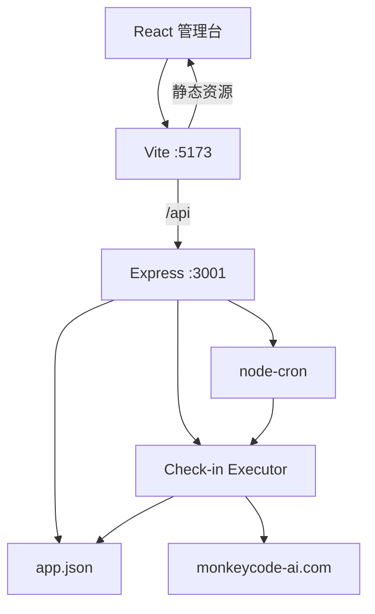

# 架构设计

## 系统概述

前后端分离的本地应用。浏览器只访问 Vite 开发服务器；`/api` 由 Vite 反代到 Express。后端在进程内用 node-cron 调度签到，执行器携带用户提供的会话 Cookie 调用 MonkeyCode 国内站接口，结果写入 `backend/data/app.json`。

## 技术栈

- 前端：Vite 5、React 18、TypeScript
- 后端：Node.js 20、Express、node-cron、undici/fetch
- 存储：`backend/data/app.json`
- 启动：`start.sh` 先后拉起后端 3001 与前端 5173

## 项目结构（建议）

```
frontend/
  src/pages/          首页、账号、任务、记录
  src/api.ts          同源 /api 客户端
  vite.config.ts      proxy /api -> localhost:3001，allowedHosts
backend/
  src/routes/         accounts、tasks、records
  src/store/          JSON 读写
  src/scheduler/      Cron 注册
  src/checkin/        执行器、PoW、平台客户端
  data/app.json       运行时数据
start.sh
```

## 核心模块/组件

| 模块 | 职责 |
|------|------|
| Web 管理台 | 账号、Cron、立即执行、记录展示 |
| JSON Store | 原子写入账号/任务/记录 |
| Scheduler | 按任务 Cron 与时区注册 job |
| Executor | 单账号互斥、签到编排、写记录 |
| MonkeyCode Client | wallet、checkin、captcha HTTP |

## 架构图



## 关键流程

1. 用户保存账号凭证与 Cron（默认 `0 8 * * *`，时区 `Asia/Shanghai`）
2. 后端校验 Cron，写入 JSON，注册 cron job
3. 命中时刻或「立即执行」进入 Executor
4. 查询 `GET /api/v1/users/wallet/checkin`；已签到则记 `skipped`
5. 未签到则 challenge → 本地 PoW → redeem → checkin
6. 用签到前后钱包余额差写入 `pointsDelta`

## 设计决策

- 仅国内站：账号池与国际站不互通，首期减少站点分支
- 凭证由用户粘贴：管理台不实现登录/扫码
- 失败不重试：每日一次任务，等下次 Cron 即可
- JSON 存储：预览环境零运维
- 前端反代：预览只暴露一个端口
