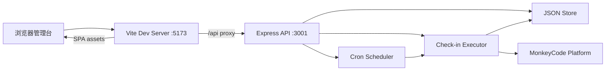
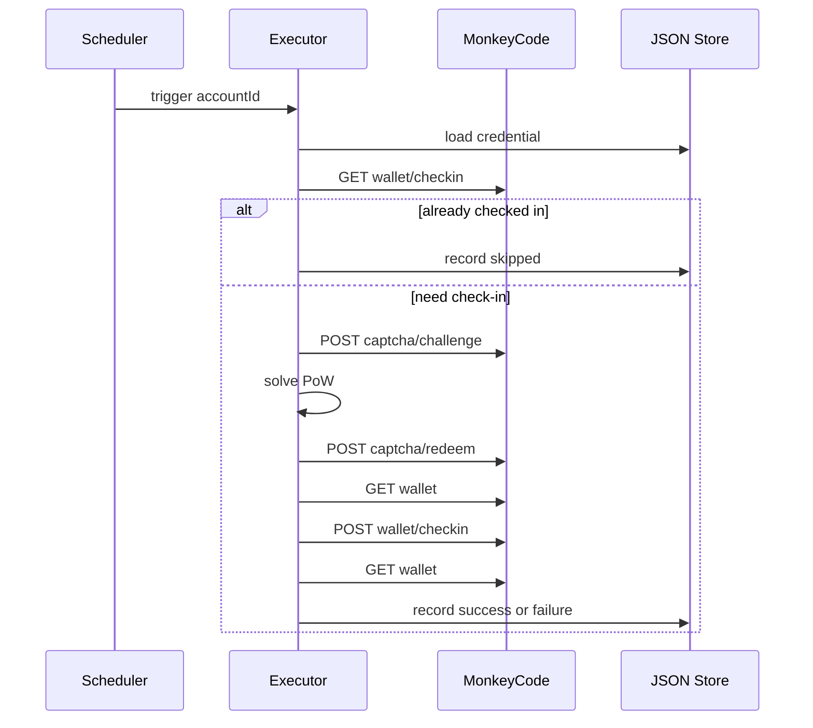

# 自动签到云任务

Feature Name: auto-checkin-cloud-task
Updated: 2026-11-11

## Description

本地 Web 管理台，按 Cron 调度 MonkeyCode 国内站每日签到。用户录入 `monkeycode_ai_session` 会话凭证，配置执行时间，查看执行记录。前端 Vite 开发服务器作为唯一对外端口，`/api` 反代到 Node.js 后端。账号、任务、记录保存在工作区 JSON 文件。

## Architecture



进程模型：`start.sh` 先起后端 `3001`，再起前端 `5173`。预览环境只暴露前端端口。后端启动时从 JSON 恢复任务并注册 Cron。



## Components and Interfaces

### Frontend (`frontend/`)

Vite + React + TypeScript。页面：

- 首页：账号卡片、下次执行时间、最近状态、立即执行
- 账号表单：名称、Session Credential、启用开关
- 任务表单：Cron、时区（默认 `Asia/Shanghai`）
- 执行记录：倒序列表，可按账号筛选

API 客户端一律请求同源 `/api/...`。

### Backend (`backend/`)

Express + TypeScript。模块划分：

| 模块 | 职责 |
|------|------|
| `routes/accounts.ts` | 账号 CRUD |
| `routes/tasks.ts` | 任务 CRUD、立即执行 |
| `routes/records.ts` | 执行记录查询 |
| `store/jsonStore.ts` | 读写 `data/app.json` |
| `scheduler/cron.ts` | node-cron 注册/注销 |
| `checkin/executor.ts` | 签到编排与单账号互斥 |
| `checkin/pow.ts` | 平台 PoW 求解 |
| `checkin/client.ts` | MonkeyCode HTTP 客户端 |

对外 HTTP 接口见 当前工作区 `.monkeycode/docs/INTERFACES.md`（规划阶段同步写入）。

### Check-in protocol

目标站点：`https://monkeycode-ai.com`。鉴权头：`Cookie: monkeycode_ai_session=<value>`。

1. `GET /api/v1/users/wallet/checkin` → `{ checked_in }`
2. 已签到则结束，状态 `skipped`
3. `POST /api/v1/public/captcha/challenge` body `{}` → `{ token, challenge: {c,s,d} }`
4. 本地求解 c 道题（1-based 下标，FNV-1a + xorshift32，SHA-256 十六进制前缀匹配）
5. `POST /api/v1/public/captcha/redeem` body `{ token, solutions }` → `{ token: captcha_token }`
6. 读取 `GET /api/v1/users/wallet` 得到签到前余额
7. `POST /api/v1/users/wallet/checkin` body `{ captcha_token }`
8. 再读钱包，余额差作为积分变动

单题上限 2000 万次哈希，全局预算 500 万次。超出预算记失败 `captcha_budget_exceeded`。

### Scheduler

使用 `node-cron`。每条启用任务对应一个 cron job，key 为 `accountId`。进程启动调用 `restoreJobs()`。任务更新先 `stop` 再 `start`。立即执行走同一 `executor.run(accountId)`，与 Cron 共享账号级互斥锁。

失败策略：当次写入 Execution Record 后结束，等待下一次 Cron。

## Data Models

持久化文件：`backend/data/app.json`

```json
{
  "accounts": [
    {
      "id": "acc_xxx",
      "name": "主账号",
      "site": "monkeycode-cn",
      "credential": "完整会话字符串",
      "enabled": true,
      "createdAt": "2026-11-11T00:00:00.000Z",
      "updatedAt": "2026-11-11T00:00:00.000Z"
    }
  ],
  "tasks": [
    {
      "id": "task_xxx",
      "accountId": "acc_xxx",
      "cron": "0 8 * * *",
      "timezone": "Asia/Shanghai",
      "enabled": true,
      "updatedAt": "2026-11-11T00:00:00.000Z"
    }
  ],
  "records": [
    {
      "id": "rec_xxx",
      "accountId": "acc_xxx",
      "startedAt": "2026-11-11T00:08:00.000Z",
      "finishedAt": "2026-11-11T00:08:02.000Z",
      "status": "success",
      "pointsDelta": 100,
      "error": null
    }
  ]
}
```

`status` 枚举：`success` | `skipped` | `auth_failed` | `failed`。

API 响应中 `credential` 替换为 `********` + 末 8 字符。磁盘文件保存完整凭证。`records` 超过 500 条时截断为最新 500。

写入采用「先写临时文件再 rename」以保证单次写入原子。

## Correctness Properties

- 同一 `accountId` 同一时刻仅有一次签到在飞。
- `checked_in === true` 时执行器零写请求。
- PoW 题目下标从 1 开始；前缀比较使用十六进制字符串。
- Cron 按任务 `timezone` 解释，默认 `Asia/Shanghai`。
- 后端重启后，所有 `enabled === true` 的任务重新注册。
- 日志与错误摘要禁止输出完整 Session Credential。

## Error Handling

| 场景 | 处理 |
|------|------|
| Cron 非法 | HTTP 400，提示「Cron 表达式格式无效」 |
| 凭证为空 | HTTP 400，提示「会话凭证不能为空」 |
| 账号签到进行中 | HTTP 409，提示「该账号签到正在进行」 |
| 平台 401 | 记录 `auth_failed`，页面提示更新凭证 |
| PoW 无法完成 | 记录 `failed`，错误码 `captcha_budget_exceeded` 或 `captcha_invalid` |
| 平台签到失败 | 记录 `failed`，保存 HTTP 状态与响应摘要 |
| 钱包读取失败 | 状态仍按签到结果判定，`pointsDelta = 0`，说明「余额读取失败」 |
| `app.json` 损坏 | 以空配置启动，首页横幅「配置数据无法读取，请检查数据文件」 |
| 平台超时（10s） | 记录 `failed`，错误摘要「请求超时」 |

## Test Strategy

- `pow.test.ts`：固定 challenge 向量求解，覆盖 1-based 下标与十六进制前缀。
- `executor.test.ts`：已签到跳过、401 映射、互斥锁、余额差计算；HTTP 用 mock。
- `cron.test.ts`：非法表达式拒绝、启用/停用注册、启动恢复。
- `store.test.ts`：读写往返、凭证掩码仅发生在 API 层、记录截断 500。
- `accounts.api.test.ts`：空凭证 400、列表掩码、删除后任务停止。

运行：`cd backend && npm test`。

## References

[^1]: (Website) - [MonkeyCode 积分说明](https://monkeycode.docs.baizhi.cloud/node/019d963c-425a-7c49-8126-d5308fd61cdc)
[^2]: (Website) - [magpie-monkeycode internals 签到协议](https://github.com/MYCF711/magpie-monkeycode/blob/main/docs/internals.md)
